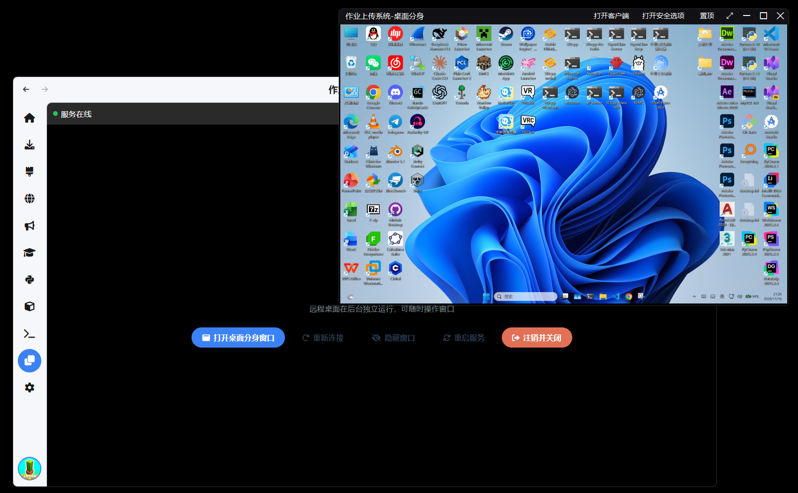
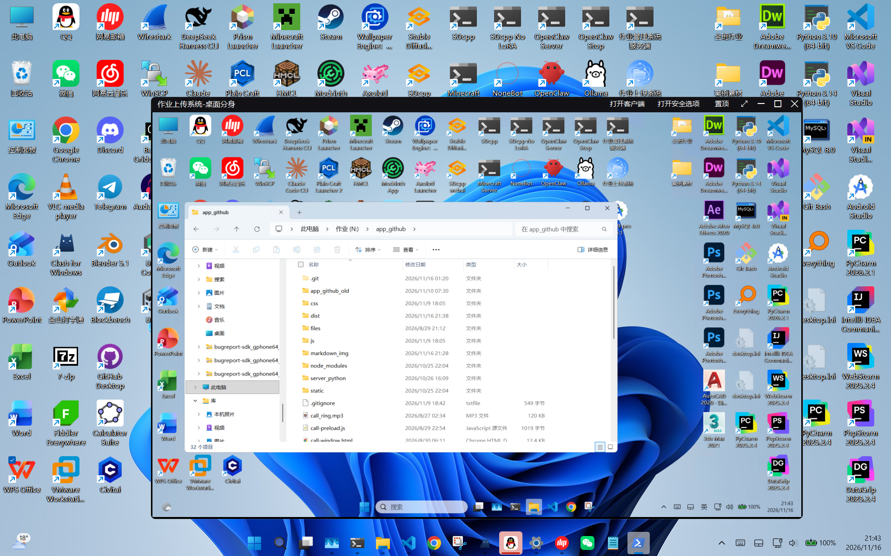

<div align="center">

  

  <h1>作业上传系统 · upload_system_client</h1>

  <p>
    <a href="https://github.com/anghaoyu16/upload_system_client/releases">
      
    </a>
  </p>

  <p>
    作业上传系统 · upload_system_client - 局域网作业互传/素材下载 | 支持生成Excel统计作业情况名单 | 自动选择后端IP 优先局域网 | 超多个性化配置 | 内置浏览器 | 自定义浏览器UA | 内置可模仿超星学习通皮肤 | 适配超星学习通 | Windows桌面分身 | 学习通AI 辅助答题 | MMD 模型预览 | 命令行 与大量基于electron集成的功能
  </p>

</div>

---
## APP 截图预览

### 首页


### 桌面分身



### 个性化


### MMD/图片 与 AI配置项


### 设置


### 模仿学习通APP主题与AI功能


### Python 编辑器


---

## 功能特性

- **作业与素材管理**：目录树管理、权限管理、压缩包批量下载、代交作业、统计提交情况(跳过班级名单，递归识别各层级作业文件夹并自动生成Excel，支持导出)
- **多后端自动切换**：按 `backends` 配置自动探测可用服务器，优先局域网，失败后自动回退公网
- **AI 辅助答题**：基于 OpenAI 兼容接口的智能对话，可调用页面工具（MMD / 内置浏览器 / 学习通）
- **学习通集成**：独立登录、免登录浏览、环信即时聊天、窗口抖动提示
- **内置浏览器**：自定义 User-Agent、透明背景
- **MMD 模型预览**：支持 PMX、PMD、GLB、GLTF、OBJ、VRM，可配置描边、光晕、贴图与动画
- **Python 编辑器与 REPL**：内置 Python 运行环境
- **个性化**：主题色、深色模式、自定义背景与启动动画、毛玻璃、点击穿透
- **桌面分身**：基于系统原生 RDP 的独立子窗口，支持 F7 全局快捷键全屏
- **彩蛋**：anghaoyu16://dance 与 anghaoyu16://windows

## 所有快捷键列表
<table align="center">
  <thead>
    <tr><th>快捷键</th><th>功能</th><th>快捷键范围</th><th>默认是否启用</th></tr>
  </thead>
  <tbody>
    <tr><td><kbd>F1</kbd></td><td>切换学习通皮肤</td><td>窗口级</td><td>是</td></tr>
    <tr><td><kbd>F3</kbd></td><td>显示/隐藏 MMD（或图片）的 AI 小窗口</td><td>窗口级</td><td>是</td></tr>
    <tr><td><kbd>F7</kbd></td><td>桌面分身窗口全屏</td><td>窗口级</td><td>是</td></tr>
    <tr><td><kbd>F9</kbd></td><td>显示/隐藏学习通页面选项卡</td><td>窗口级</td><td>是</td></tr>
    <tr><td><kbd>F10</kbd></td><td>显示/隐藏浏览器页面选项卡</td><td>窗口级</td><td>是</td></tr>
    <tr><td><kbd>F11</kbd></td><td>切换/退出全屏</td><td>窗口级</td><td>是</td></tr>
    <tr><td><kbd>F12</kbd> / <kbd>Ctrl+Shift+I</kbd></td><td>打开开发者工具</td><td>窗口级</td><td>是</td></tr>
    <tr><td><kbd>Ctrl</kbd> + <kbd>+</kbd></td><td>放大整个 APP 页面</td><td>窗口级</td><td>是</td></tr>
    <tr><td><kbd>Ctrl</kbd> + <kbd>-</kbd></td><td>缩小整个 APP 页面</td><td>窗口级</td><td>是</td></tr>
    <tr><td><kbd>Ctrl+Shift+Alt+Z</kbd></td><td>显示/关闭 APP 窗口</td><td>全局快捷键</td><td>是</td></tr>
    <tr><td><kbd>Ctrl+Shift+Alt+I</kbd></td><td>打开开发者工具窗口</td><td>全局快捷键</td><td>是</td></tr>
    <tr><td><kbd>Ctrl+Shift+Alt+X</kbd></td><td>启用/禁用窗口穿透点击</td><td>全局快捷键</td><td>是</td></tr>
    <tr><td><kbd>Ctrl+Shift+Alt+T</kbd></td><td>启用/禁用窗口置顶</td><td>全局快捷键</td><td>是</td></tr>
    <tr><td><kbd>Ctrl+Shift+Alt+M</kbd></td><td>切换深色/浅色主题</td><td>全局快捷键</td><td>是</td></tr>
    <tr><td><kbd>Ctrl+Shift+Alt+</kbd>+<kbd></kbd></td><td>增大窗口透明度</td><td>全局快捷键</td><td>是</td></tr>
    <tr><td><kbd>Ctrl+Shift+Alt+</kbd>-<kbd></kbd></td><td>减小窗口透明度</td><td>全局快捷键</td><td>是</td></tr>
  </tbody>
</table>
<p><em>快捷键范围说明：<b>窗口级</b>表示仅在 APP 窗口聚焦时生效；<b>全局快捷键</b>表示在任何窗口下均生效</em></p>

---

## 前置要求

| 环境 | 版本要求 |
|------|----------|
| Node.js | ≥ 18 |
| Python | ≥ 3.9 |
| pip | 最新即可 |

> 主服务默认监听 **80** 端口，Linux 下可能需要以root身份运行，或先释放 80 端口占用。

---

## 快速上手

# 方案一:离线使用该APP，不配置服务器

直接下载Releases内的APP即安装可离线使用

注意:桌面分身的登录密码不是你的PIN，是你登录的微软账户的密码
如果你没有登录微软账户，登录密码就是你的设备的登录密码
每次连接都需要通过 **Windows安全中心** 进行连接

# 方案二:配置服务器，使用网络上传作业与使用更多功能

可以在127.0.0.1:50 管理服务端用户信息与配置用户
(tip:用户列表内 开发者用户可以在app内获得更多的管理权限，可以管理作业上交，上传，重命名，更改作业)
(后续可能移除这个50端口，直接和 APP 的开发者人员功能合并)

### 第一步：克隆并安装依赖

```bash
git clone https://github.com/wanghaoyu16/upload_system_client.git
cd upload_system_client

npm install      # 安装 Electron 及前端依赖（easemob-websdk、agora-rtc-sdk-ng、three 等）
```

### 第二步：配置服务器

```bash
cd server_python
copy config.example.json config.json   # Windows
# cp config.example.json config.json   # macOS / Linux
```

打开 `config.json`，把占位符替换成你自己的信息：

```json
{
  "backends": [
    "http://192.168.1.100",
    "http://10.0.0.50",
    "http://你的公网IP:端口",
    "http://127.0.0.1"
  ],
  "xxt_excel_filename": "班级名单.xlsx",
  "xxt_default_password": "你的默认密码",
  "update_version_url": "http://你的服务器/version.json",
  "data_dir": "./data"
}
```

> 字段含义见下方 [配置说明](#配置说明)。

同时配置客户端探测地址：

```bash
# 回到项目根目录
cd ..
copy config.example.json config.json   # Windows
# cp config.example.json config.json   # macOS / Linux
```

打开根目录的 `config.json`，填入你的后端地址：

```json
{
  "backends": [
    "http://192.168.1.100",
    "http://10.0.0.50",
    "http://你的公网IP:80",
    "http://127.0.0.1"
  ],
  "updateHost": "192.168.1.100"
}
```

| 字段 | 说明 |
|------|------|
| `backends` | 客户端探测地址列表，按顺序尝试连接 |
| `updateHost` | 版本更新服务器 IP（不带协议和路径） |

### 第三步：放入学习通数据与班级名单（可选）

#### 1. 班级名单（作业统计用）

“统计提交情况”功能会读取班级名单，用于按真实姓名匹配作业文件并生成统计 Excel。将班级名单放到 `server_python/file/classuser/`，文件名固定为 `zn2501.xlsx`（对应代码中的 `CLASS_USER_XLSX`）。

| 位置 | 内容 |
|------|------|
| 第 1~2 行任意列 | 班级名（标题文字，可合并单元格；跳过“序号/姓名/学号/编号/班级”等表头词，未找到时回退读取 A3） |
| 第 3 行起 · B 列 | 姓名（遇空单元格结束） |
| 第 3 行起 · C 列 | 学号 |

示例：

| A | B | C | D |
|---|---|---|---|
| 第 1 列 | 班级名字 |
| 第 2 列 | 序号 | 姓名 | 学号 |
| 第 3 列 | 1 | xxx | 16161600 |
| 第 4 列 | 2 | xxx | 16161601 |

> 统计按“文件名包含真实姓名”匹配，无法匹配的文件会在前端弹窗提示并跳过不计入统计。

#### 2. 学习通数据（可选）

如果你的场景不需要学习通，跳过此步。

将班级 Excel 放到 `server_python/file/xxt/`，文件名与 `config.json` 中的 `xxt_excel_filename` 保持一致。

> **注意**：`app.py` 读取 Excel 的列位置是**硬编码**的，从第 2 行开始，最多读到第 44 行：

| 列 | 内容 |
|----|------|
| 第 5 列（E） | 学习通账号 |
| 第 6 列（F） | 姓名 |
| 第 7 列（G） | 密码（留空则使用 `xxt_default_password`） |

示例（前 4 列可以是学号、班级等任意内容）：

| 学号 | 班级 | 备注 | 序号 | 学习通账号 | 姓名 | 密码 |
|------|------|------|------|-----------|------|------|
| 161616 | xxx班 | - | 1 | xxxxxxx | xxx | abc123 |

### 第四步：启动

```bash
# 终端 1：启动后端服务器
cd server_python
pip install flask openpyxl         # 首次需要
python app.py                      # 主服务 → http://127.0.0.1:80
python admin_app.py                # 管理后台 → http://127.0.0.1:50

# 终端 2：启动客户端
cd ..                              # 回到项目根目录
npm start                          # 启动 Electron 窗口
```

客户端启动后会自动探测 `backends` 列表中第一个可用的服务器并连接。

---

## 配置说明

`server_python/config.json` 各字段：

| 字段 | 类型 | 说明 |
|------|------|------|
| `backends` | string[] | 后端地址列表，客户端按顺序探测，连上第一个可用的 |
| `xxt_excel_filename` | string | 学习通班级 Excel 文件名，放在 `server_python/file/xxt/` 下 |
| `xxt_default_password` | string | Excel 中某行未填密码时使用的默认密码 |
| `update_version_url` | string | `/api/check_update` 回退使用的版本 JSON 地址 |
| `data_dir` | string | 数据存储根目录。`"./data"` 相对启动目录；也可填绝对路径如 `D:\server_data` |

**版本 JSON 字段（用于客户端更新检测）**：

```json
{
  "version": "1.4.3",
  "download_url": "http://你的服务器/file/app/upload-system-setup.exe",
  "release_notes": "本次更新内容...(这个可以随便写，因为最新版客户端不会展示这个字段)"
}
```

- 稳定版：`{服务器}/file/app/version.json`
- 测试版：`{服务器}/file/app_beta/version.json`

---

## 目录说明

```
项目根目录/
├── config.example.json      # 客户端配置模板（可提交）
├── config.json              # 客户端配置（不提交）
├── main.js                  # Electron 主进程（窗口、托盘、更新、学习通 SSO、通话窗口等）
├── preload.js               # 预加载脚本（安全桥接，含 MMD 模型/图片本地存储）
├── call-preload.js          # 来电窗口预加载（Agora RTC）
├── webview-preload.js       # webview 预加载（拦截 window.open / 下载 / 考试链接）
├── xxt-preload.js           # 学习通登录窗口预加载（截获环信凭据）
├── index.html               # 主界面
├── call-window.html         # 来电窗口
├── dev-panel.html           # 开发者控制面板
├── rdp-child.ps1            # 桌面分身窗口（WinForms + MsRdpClient10）
├── rdp-child.cmd            # 桌面分身指令通道（主进程 ↔ PowerShell 通信）
├── icon_rdp.ico             # 桌面分身窗口图标
├── js/
│   ├── app.js               # 前端核心逻辑（登录、树、上传下载、学习通、浏览器、Python...）
│   ├── mmd.js               # MMD 模型加载/预览/配置
│   ├── mmd_ai.js            # MMD 模型 AI 对话
│   └── three/               # three.js 及其 addons
├── css/                     # 样式
├── static/                  # 图标、字体、Cropper 等静态资源
├── server_python/
│   ├── app.py               # Flask 主服务（端口 80）
│   ├── admin_app.py         # Flask 管理后台（端口 50）
│   ├── config.example.json  # 配置模板（可提交）
│   ├── config.json          # 你的配置（不提交）
│   ├── data/                # 运行时数据（不提交）
│   │   ├── file/classuser/  # 班级用户数据
│   │   ├── file/work/       # 作业目录
│   │   ├── file/resource/   # 素材目录
│   │   ├── file/xxt/        # 学习通 Excel
│   │   ├── file/app/        # 正式版更新包
│   │   ├── file/app_beta/   # 测试版更新包
│   │   └── userdata/        # 用户 / token / 头像 / 通知
│   └── templates/           # 管理后台页面
└── package.json
```

---

## 需要手动修改的位置

所有敏感配置已从代码中移除，改为从配置文件读取：

| 配置文件 | 位置 | 用途 |
|----------|------|------|
| `config.json`（根目录） | 项目根目录 | 客户端后端探测列表、更新服务器 IP |
| `server_python/config.json` | server_python/ | 后端服务配置、学习通数据、存储路径 |

两个配置文件均需从 `config.example.json` 复制后填写。详细说明见上方 [配置服务器](#第二步配置服务器) 步骤。

---

## 常见问题/解决方案

**Q：启动报错 `No module named 'flask'`？**

```bash
pip install flask openpyxl werkzeug
```

**Q：`python app.py` 启动失败 / 80 端口被占用？**

- Windows 下 80 端口常被 IIS、其他 Web 服务占用，可用 `netstat -ano | findstr :80` 查看占用进程
- 以管理员身份运行命令行
- 如实在无法释放，可修改 `app.py` 末尾 `port=80` 为其他端口，并同步修改两个 `config.json` 中的地址

**Q：客户端一直显示"连不上服务器"？**

- 检查根目录 `config.json` 中 `backends` 地址是否正确
- 确认 Python 服务已启动（80 端口主服务、50 端口管理后台）
- 防火墙是否放行了对应端口

**Q：学习通显示"服务器没用你的学习通信息"？**

- 确认 Excel 已放到 `server_python/file/xxt/` 下
- 确认 Excel 第 5/6/7 列分别是账号、姓名、密码（从第 2 行开始）
- 确认 `config.json` 中 `xxt_excel_filename` 文件名正确
- 也可在「设置 → 学习通 → 更改本地学习通账户」中手动填写覆盖

**Q：如何更新客户端？**

- 稳定版：把 `version.json` 放到 `{data_dir}/file/app/`，`version` 大于当前版本即可
- 测试版：放到 `{data_dir}/file/app_beta/`，并在「设置 → 常规」中开启「接收测试版本更新」
- 客户端仅在对局域网后端连接时自动静默检查，公网后端需手动点「检查更新」


---

## 技术栈

| 层 | 技术 |
|----|------|
| 桌面客户端 | Electron + PowerShell(C#)(RDP 子会话控件脚本) |
| 前端 | 原生 HTML / CSS / JavaScript |
| 桌面分身 | Windows RDP ActiveX（COM / P-Invoke）+ 键盘钩子（WH_KEYBOARD_LL） |
| 后端 | Python Flask + openpyxl |
| 3D 渲染 | three.js（MMD / GLTF / OBJ / VRM Loader、EffectComposer） |
| AI 对话 | OpenAI 兼容接口（可配置 Base URL） |
| 第三方集成 | 超星学习通（皮肤模拟 / 模拟超星学习通客户端UA） |

> 声明：项目内置的学习通界面为高仿模拟实现，**非直接复制官方 APP**，与学习通官方无任何关联，仅供学习与研究使用。

---

## 参与贡献

欢迎提交 Issue 和 Pull Request。

注意：
- **不要**在 PR 中包含 `config.json` 或任何含真实 IP / 密码的文件
- 新增配置项请同步更新两个 `config.example.json`（根目录和 server_python/）
- Python 服务端用 `app.py` 中的 `_server_cfg.get('key', default)` 读取配置
- Electron 客户端通过 `preload.js` 的 `getClientConfig()` 读取根目录 `config.json`

---

## License

MIT © anghaoyu16

## 免责声明 / Disclaimer

- 本项目为个人学习与研究项目，与学习通、环信、Agora、OpenAI 等第三方服务无官方关联
- 使用本项目访问第三方服务时，请自行遵守对应平台的服务条款与所在学校规定
- 请勿将本项目用于违反学术诚信或平台规则的用途